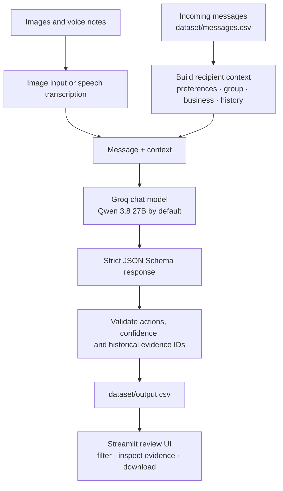

# WhatsApp Notification Router

<p>
  
  
  
  
</p>

An AI-assisted message router that classifies incoming WhatsApp-style messages for each recipient as **`notify`**, **`digest`**, or **`mute`**. Decisions use message content, user preferences, group and business metadata, historical interactions, and—where available—image or voice-note content.

**Demo:** [Open the Streamlit app](https://wa-router-ridhorezkyanwar.streamlit.app/)

> **Scope:** This repository is a dataset-driven prototype and review interface, not a WhatsApp integration. It does not connect to a user's WhatsApp account or automatically control notifications on a phone.

## How it works



The batch router reads input and supporting context from `dataset/`, creates one decision per row in `messages.csv`, and writes the results to `dataset/output.csv`. The Streamlit UI reviews the saved results, displays relevant historical evidence and local media, and can run the batch process again.

## Routing decisions

| Action | Meaning |
| --- | --- |
| `notify` | Important or time-sensitive; interrupt now |
| `digest` | Useful but not urgent; review later |
| `mute` | Unwanted, repetitive, suspicious, scam-like, or low-value for this recipient |

Message categories accepted by the output schema are `personal`, `urgent`, `event`, `payment`, `business_update`, `promotion`, `greeting`, `forward`, `spam`, `scam`, and `unknown`.

Personalization context can include DND preferences, group membership and mute history, business verification and domain metadata, opt-outs, and selected historical message interactions. The prompt also treats instructions inside incoming text or images as untrusted content rather than routing instructions.

## Recent routing reliability improvements

- **Structured output:** `code/main.py` requests a strict JSON Schema response. The allowed action and message-type values are explicit enums, and `sanitize()` clamps confidence to the `0–1` range and removes evidence IDs that were not retrieved for that message. The default model is `qwen/qwen3.8-27b`; this model supports Groq Structured Outputs. See [Groq Structured Outputs](https://console.groq.com/docs/structured-outputs).
- **Rate-limit retry:** the router retries HTTP 429 responses up to 12 times, checking the provider's `retry-after` and token-reset timing headers when available and falling back to a delay schedule if not. This reduces some transient rate-limit failures; it cannot overcome an exhausted account quota or guarantee the batch will finish. See [Groq rate-limit guidance](https://console.groq.com/docs/rate-limits).
- **Preserve existing output on failure:** the batch runner writes to a temporary output file and replaces `dataset/output.csv` only after every input row has completed. A routing/transcription error aborts the run rather than writing a partially generated output file.
- **Streamlit Secrets:** the UI reads `GROQ_API_KEY` from the process environment or Streamlit Secrets, so the key need not be committed to the repository.

These are implementation behaviors visible in the code. They are **not** a claim that a full 110-message batch or a live Groq request was successfully tested after the latest changes.

## Repository layout

```text
.
├── README.md
├── problem_statement.md
├── code/
│   ├── app.py                 # Streamlit review UI
│   ├── main.py                # Batch routing and output generation
│   ├── requirements.txt
│   ├── final_check.py         # Output-format validation helper
│   └── evaluation/
│       └── evaluate.py        # Evaluation helper
└── dataset/
    ├── messages.csv           # Incoming messages to classify
    ├── output.csv             # Saved predictions / output destination
    ├── sample_messages.csv    # Example output format
    ├── users.csv
    ├── groups.csv
    ├── group_members.csv
    ├── business_accounts.csv
    ├── user_business_history.csv
    ├── message_history.csv
    ├── message_events.csv
    ├── images.csv
    ├── voice_notes.csv
    └── media/                 # Image and audio files used by the dataset
```

## Run locally

Requirements: Python, pip, internet access for Groq inference, and a Groq API key.

### Windows PowerShell

```powershell
python -m venv .venv
.venv\Scripts\Activate.ps1
python -m pip install -r code\requirements.txt
$env:GROQ_API_KEY = "your-groq-api-key"
python -m streamlit run code\app.py --server.address 127.0.0.1 --server.port 8502
```

### Linux / macOS

```bash
python3 -m venv .venv
source .venv/bin/activate
python -m pip install -r code/requirements.txt
export GROQ_API_KEY="your-groq-api-key"
python -m streamlit run code/app.py --server.address 127.0.0.1 --server.port 8502
```

Open the local URL printed by Streamlit. Keep the terminal running while you use the app.

### Run batch routing without the UI

With the environment activated and `GROQ_API_KEY` set:

```bash
python code/main.py
```

The default model is `qwen/qwen3.8-27b`. Set `GROQ_MODEL` to choose another compatible model. **Note:** strict JSON Schema support is model-dependent; the code's current schema format is specifically configured for the default model.

## Deploy to Streamlit Community Cloud

1. Select repository `ridhorezkyanwar/whatsapp-notification-router` and branch `main`.
2. Set **Main file path** to `code/app.py`.
3. Open **Manage app → Settings → Secrets** and add:

   ```toml
   GROQ_API_KEY = "your-groq-api-key"
   ```

4. Save and reboot the app.

Do not paste an API key into chat or commit it to GitHub. If a key is exposed, revoke it and create a replacement.

## Output contract

The router writes exactly these columns, in order:

```text
message_id,action,message_type,reason,confidence,evidence_message_ids
```

- `message_id`: ID of the incoming message.
- `action`: `notify`, `digest`, or `mute`.
- `message_type`: one of the accepted categories above.
- `reason`: short explanation for the decision.
- `confidence`: numeric value clamped to `0–1`.
- `evidence_message_ids`: semicolon-separated relevant historical IDs, filtered to the evidence collected for this recipient; `none` if no valid ID remains.

The current `dataset/output.csv` shows saved predictions, not verified ground truth. Running the model again may change those predictions and can consume Groq API quota or credits.

## Validation

The repository includes `code/final_check.py` for checking output row coverage, duplicate IDs, column order, allowed categories, confidence range, and missing values. Run it from the repository root after generating output:

```bash
python code/final_check.py
```

This helper validates the CSV shape and values; it does not establish that the AI made semantically correct decisions. I do not claim a passing full-run result unless the validation script and the batch inference have actually been run in the target environment.

## Privacy and limitations

- Batch inference sends message text and selected context to Groq. Voice-note audio is sent for transcription, and images are sent to the vision-capable model when a matching local file exists.
- The dataset may contain personal, group, business, or historical interaction information. Use only data you are authorized to process; remove or anonymize sensitive material before sending it to an external model provider.
- Predictions are model-generated and can be wrong. Confidence is model-reported and clamped to a range; it is not a calibrated probability.
- The application is not connected to WhatsApp and does not send notifications, mute chats, or schedule digests on a device.
- Rate-limit retries do not guarantee recovery from daily/token quota exhaustion, provider outages, invalid credentials, unsupported model settings, or transcription errors.
- The current review UI displays the saved dataset and output. It is not a production multi-user service or a privacy-isolated deployment.

## License

See [LICENSE](LICENSE).
